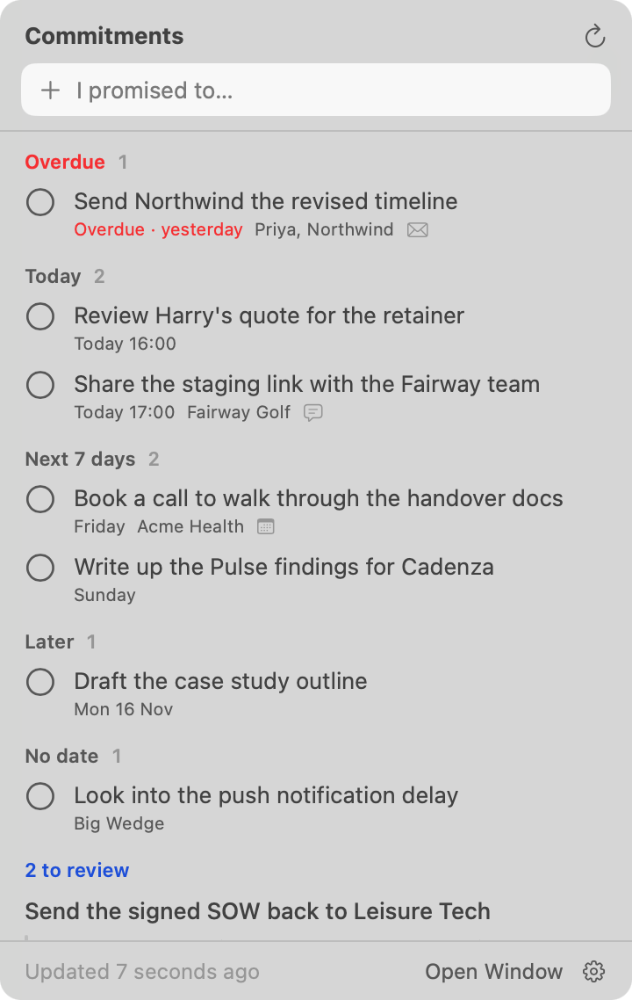
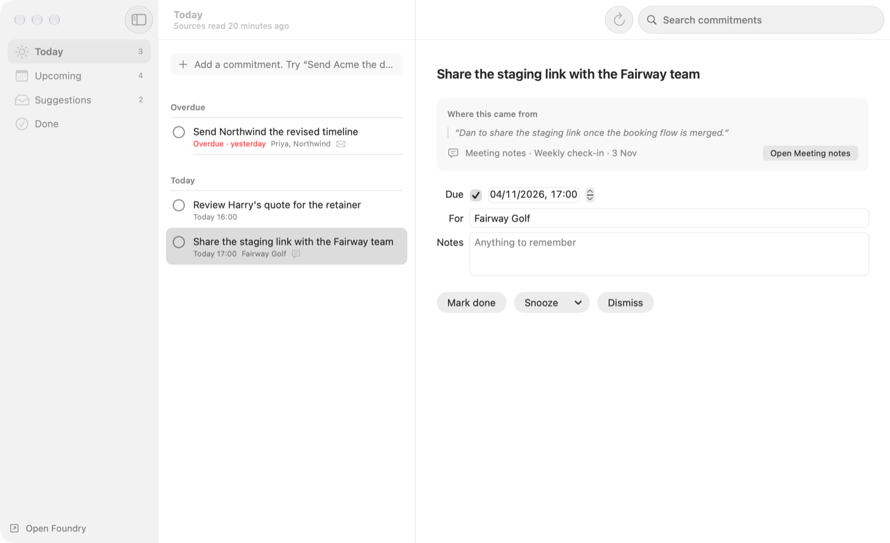
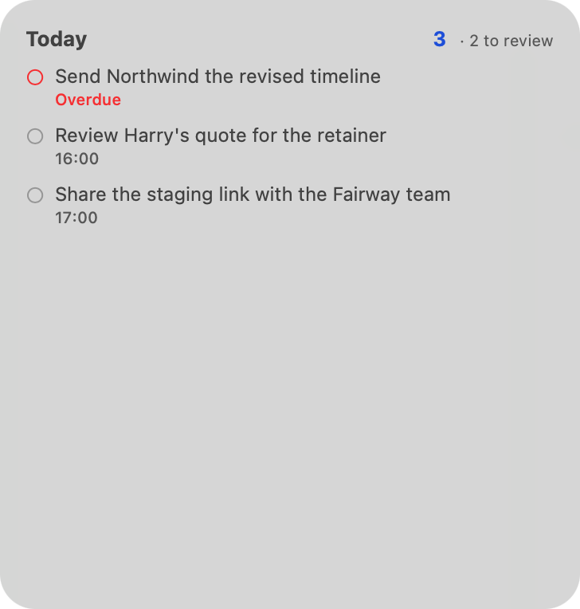
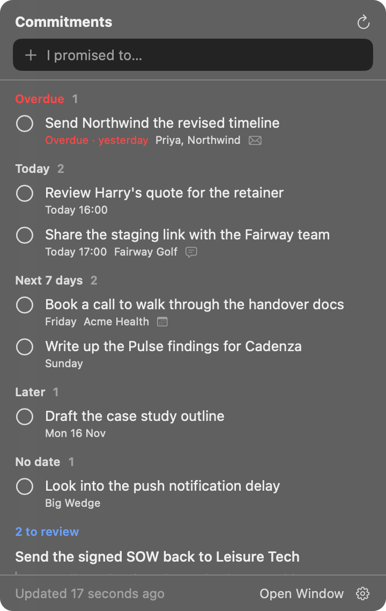
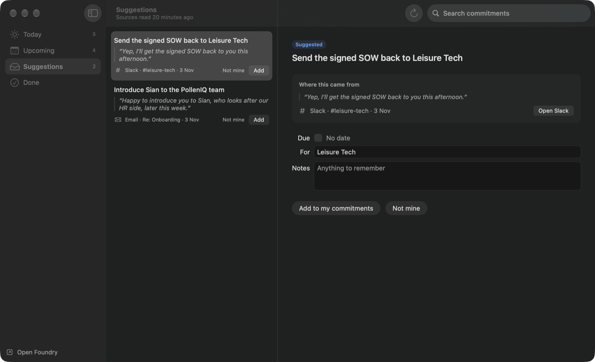
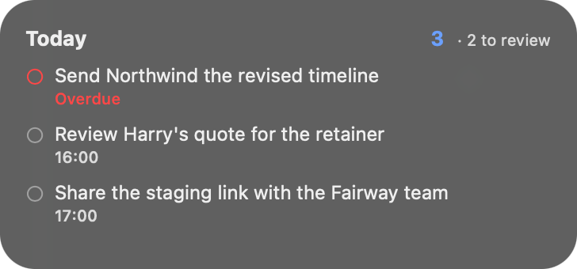

# Foundry for Mac

Your commitments: the promises you've made, in one calm list.

Foundry reads what you wrote in sent email, Slack, meeting notes and your calendar, and
**suggests** the things you said you'd do. Nothing joins your list until you add it, and the
app **never sends, replies or books anything** for you. A good day is one where you barely
open it.

| Menu bar | Window | Widget |
|---|---|---|
|  |  |  |
|  |  |  |

The data and the reading of your sources live in Foundry (Backstage → Commitments,
`Git-Dann/docs-by-gitwork`, `docs/commitments.md`). This app is a client of that API.

## What's in it

- **Menu bar.** Opens straight away from the last list it saved. Quick add at the top, then
  Overdue / Today / Next 7 days / Later / No date, then "N to review" with **Add** and
  **Not mine** on each suggestion. Tick to complete (with Undo); hover a row to snooze
  (later today, tomorrow 09:00, next Monday). The menu-bar icon shows how many are due now.
- **Window.** Today, Upcoming, Suggestions, Done. The detail pane shows the quote a suggestion
  was read from, where it came from, and a link back to the email, Slack message or meeting.
- **Quick add anywhere.** ⌃⌥Space opens a small floating field (turn off in Settings). Words at
  the end of the line become the date: `fri`, `tomorrow`, `next week`, `in 3 days`, `23 nov`.
- **Spotlight and Shortcuts.** "Add Commitment" and "Show Commitments" App Intents.
- **Notifications.** One morning digest (09:00 by default; quiet mornings send nothing) and a
  nudge when something becomes overdue, with Mark done / Tomorrow actions. A new suggestion
  never notifies you.
- **Widget.** Today's commitments (small, medium, large). It shows titles only; quotes and
  notes never leave the app.
- **Works offline.** The list is cached on disk per person. Edits made offline are applied at
  once, queued, and sent in order when Foundry is reachable again. Signing out deletes the cache.
- **Settings.** Account, notifications, the quick-add shortcut, updates; **Sources** mirrors
  `/settings` (sent email, Slack, meeting notes, calendar) and shows each source's own message
  when it couldn't be read; **Advanced** sets the API server.

## Keyboard

| | |
|---|---|
| ⌘N | New commitment (focuses quick add in the window) |
| ⇧⌘N / ⌃⌥Space | Quick add (floating) |
| ⌘K | Search |
| Space | Complete, accept or reopen the selected row (when the list has focus) |
| ⌘⌫ | Dismiss / Not mine (while typing, it keeps its text meaning) |
| ⌘S | Snooze until tomorrow 09:00 (Commitment → Snooze for the others) |
| ⌘R / ⇧⌘R | Refresh / check sources now |
| ⌘1–⌘4 | Today, Upcoming, Suggestions, Done |

## Requirements

- Xcode 26 or later (built and tested here with Xcode 27 on macOS 27); runs on macOS 26+.
- `brew install xcodegen`.
- A Foundry server with the Commitments API (docs-by-gitwork PR #804). Against a server
  without it, the app says "Commitments aren't on this Foundry server yet."

## Install on your Mac

```bash
Scripts/install-local.sh
```

Builds Release, installs it to `/Applications` (the old copy goes to the Trash) and opens it.
It's signed ad hoc, so it runs only on this Mac and the widget can't read the app's data. Once
your Apple ID is in Xcode → Settings → Accounts, `TEAM=B27Y4M6S3Y Scripts/install-local.sh`
signs it with the GIT WORK team and the widget works too.

## Build and test

```bash
xcodegen generate
xcodebuild -project Foundry.xcodeproj -scheme Foundry -destination 'platform=macOS' build test
```

The unit tests cover the API contract (camelCase keys, `null` for cleared fields, tolerant
dates), grouping, the due-date parser, snooze times, the notification plan, the widget
snapshot, and the offline queue (edits survive a relaunch and are sent in order).

### Signing and the App Group

The widget reads the app's data through the App Group `group.co.gitwork.foundry`. Xcode only
signs an App Group with a provisioning profile, so **Debug builds leave it out** (they build
unsigned, but the widget shows "Open Foundry to sign in"). **Release** carries it and needs
the Developer ID identity, as `Scripts/build-release.sh` uses in CI. The entitlements files are
committed by hand and set per configuration in `project.yml`; xcodegen doesn't rewrite them.

### Against a running server

`LiveServerTests` drive the app's own API client, store and offline queue against a real
Foundry server. They're skipped unless you pass a mobile JWT:

```bash
TEST_RUNNER_FOUNDRY_IT_TOKEN=<jwt> TEST_RUNNER_FOUNDRY_IT_BASE=http://localhost:3100 \
  xcodebuild -project Foundry.xcodeproj -scheme Foundry -destination 'platform=macOS' test
```

They add, complete, delete and change settings, so use a local or throwaway server, never a
real production account (the test refuses `foundry.gitwork.co.uk`).

### Debug-only tools

- `--demo` runs the real app with sample data, no sign-in, network, notifications or widget writes.
- `--capture <dir>` saves the window, menu-bar panel, widget and quick-add views (light and
  dark) to PNGs. It uses the window server's image of the app's own windows, so it needs no
  Screen Recording permission. The menu-bar panel and widget are the real views hosted in a
  popover-material window, not the system's own chrome.
- `-api.baseURLOverride http://localhost:3100` and `-debug.keychainService <name>` point a
  debug run at another server with its own Keychain slot.

Each server keeps its own sign-in (`auth.mobileJWT` for production, `auth.mobileJWT@host:port`
otherwise), so a 401 from a local or preview server can never sign you out of production.

## Layout

```
Foundry/
  FoundryApp.swift        Scenes (window, menu bar, settings), keyboard commands
  App/                    AppModel, AppEnvironment
  Commitments/            Model, API client, store + offline queue, grouping, due-date parser
  UI/                     Menu-bar panel, window, detail, rows, settings
  System/                 Notifications, quick add + global hotkey, App Intents, widget feed
  Shared/                 Widget snapshot, App Group store, widget view (also in the extension)
  Services/               Sign-in, Keychain, network, Sparkle
  Debug/                  Screenshot capture and sample data (DEBUG builds only)
FoundryWidgets/           WidgetKit extension: Today
FoundryTests/             Unit and live-server tests
```

## Release and updates

Unchanged: [docs/macos-release.md](docs/macos-release.md) and
[docs/macos-updates.md](docs/macos-updates.md). Sparkle keeps updating installed copies.

## Conventions

- Bundle ID `co.gitwork.foundry`. Native frameworks only.
- System materials and controls only (Liquid Glass comes from them). No hand-made blur.
- Foundry Blue `#1D4ED8` is the accent only, lifted to `#6BA0FF` in dark mode for contrast.
- The API is camelCase. Never add a snake_case key strategy.
